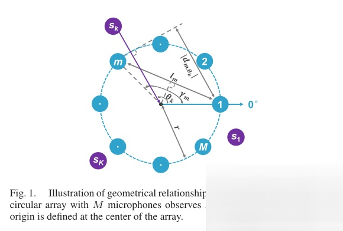
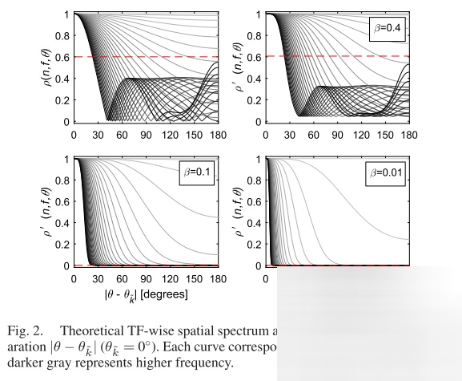
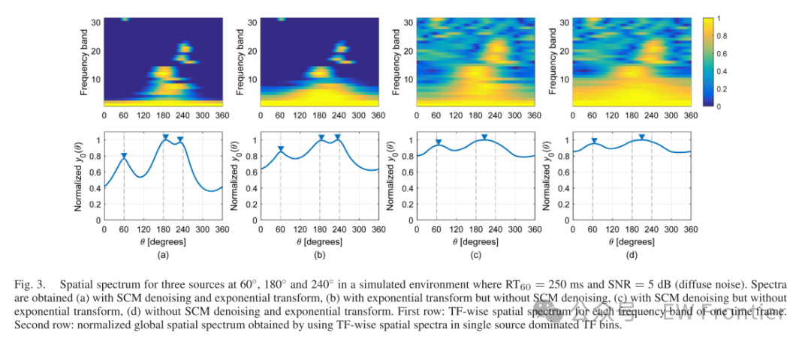
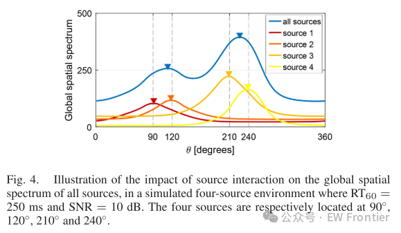
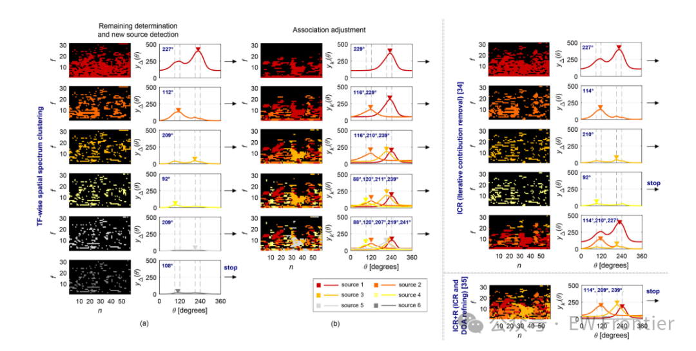
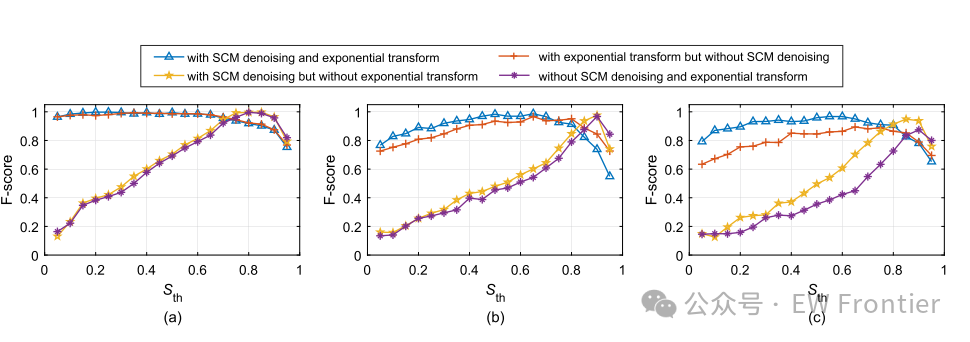
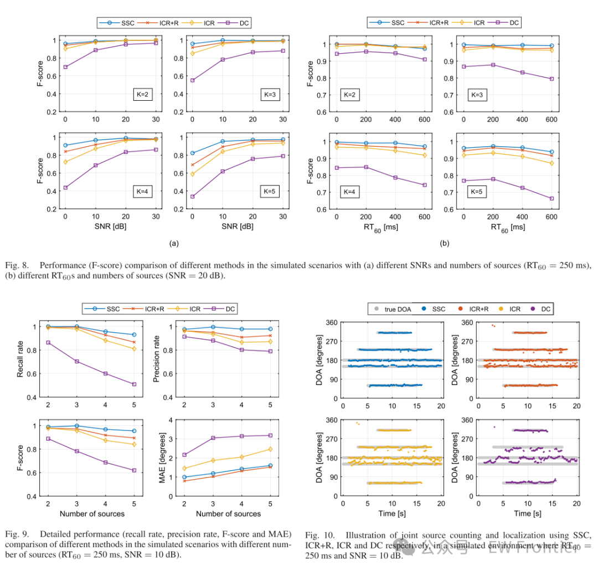

# DOA Estimation Based on TF-Wise Spatial Spectral Clustering for Multi-Source Counting and Localization [with MATLAB Code]

This paper investigates the problem of multi-source counting and localization in noisy acoustic environments using microphone array recordings. A method based on time-frequency space spectral clustering is proposed, which consists of two stages. Firstly, given the received sensor signals, a spatial correlation matrix is calculated in the TF domain and denoising is performed. The algorithm estimates the TF-wise space spectral based on signal subspace information, and enhances the TF-wise space spectral through an exponential transformation, thereby improving the reliability of the space spectral to reflect the probability of source presence. Secondly, to jointly count and localize the sources, the enhanced TF-wise space spectral are divided into multiple clusters, each corresponding to a source. The sources are continuously detected by searching for significant peaks in the remaining global space spectral, which are formed using unassigned space spectra. After detecting a new source, the space spectral are reallocated to the detected source based on their advantageous association. The process of source detection and space spectral allocation is iteratively executed to reduce the interaction between sources. Experimental validation with both simulated data and real-world data has demonstrated the effectiveness of this method in different noise and reverberation environments for multi-source counting and localization.
Introduction
The use of microphone arrays for multi-source localization is crucial in numerous acoustic signal processing tasks such as speech de-reverberation, noise reduction, and blind source separation. Over the past few decades, various source localization methods have been developed, broadly categorized into spatial spectrum methods [1]-[3] and time-frequency (TF) methods [4], [5]. Despite significant progress, the performance of these methods remains severely affected by unknown number of sources, adverse acoustic conditions, etc. [6]-[8].
Time-frequency processing methods possess the capability to jointly estimate the number of multiple sound sources and their locations. They typically assume that due to the sparsity of speech signals, at most one source dominates in the time-frequency domain. This assumption, known as the W-Disjoint Orthogonal (WDO) hypothesis [9], simplifies multi-source localization in wideband scenarios by treating each time-frequency unit as a single-source localization. When combining time-frequency processing with spatial spectrum for effective multi-source localization, two issues need to be considered: 1) How to construct a reliable time-frequency space spectrum that indicates the presence of a source by its significant peaks; 2) How to accurately locate multiple sources based on the time-frequency space spectrum, especially when the number of sources is unknown.
For time-frequency units where a single source dominates, various methods have been developed to construct the spatial spectrum as a function of source position, such as Direction of Arrival Power (SRP) [1] and Multi-signal Classification (MUSIC) [2]. Among them, signal subspace information has received in-depth research, and the characteristic vectors of the spatial correlation matrix (SCM) exhibit different properties. Typically, when the spatial correlation matrix is not severely contaminated by noise, the principal feature vector encodes the direction vector of a single source and spans the signal subspace [10],[11]. The other characteristic vectors span the noise subspace and are orthogonal to the direction vector of the source [2],[12]-[14]. Unlike the structure of the spatial correlation matrix, parametric spatial correlation matrices are designed to function as functions of candidate positions [15],[16]. The basis for localization is that when the parametric spatial correlation matrix points to the true source location, the maximum eigenvalue is maximized, while all other eigenvalues are minimized [16]. Another basis is that the determinant of the parametric spatial correlation matrix reaches a minimum value at the true source location [17],[18]. Although subspace methods can achieve high-resolution localization through fine division of candidate position spaces, they are sensitive to acoustic interference due to the possibility of disturbances in the spatial correlation matrix.
Multi-source localization requires robustness against acoustic interference. Many methods have been developed to enhance the performance of localization algorithms in environments with environmental noise, room reverberation, and interactions between sources. Ito et al. utilized the geometric information of a symmetric microphone array to improve the performance of the MUSIC algorithm in diffuse noise environments [19]. Huang et al. leveraged prior effects to robustly estimate the arrival direction (DOA) of each source in reverberant scenarios [21]. Li et al. used a segmented spatial correlation matrix subtraction method to obtain a noisy spatial correlation matrix for identifying relative transfer functions of individual speakers [23]. Pang et al. proposed a reverberation weighting method that suppresses both early and late reverberation while preserving localization clues [24]. Some methods focus on identifying time-frequency units dominated by a single source, such as coherence tests [25], single-source confidence measures [6], and directivity-dominance tests [26]. These are typically preprocessing stages in time-frequency processing methods, aiming to discard time-frequency units severely affected by multiple sources or reverberation. Inspired by these works, this paper improves the space spectrum based on signal subspace to be adaptive under different adverse acoustic conditions.
Generally, multi-source localization can be performed through three methods given the spatial spectrum of each time-frequency unit [27]. 1) Histogram method [6],[11],[28]-[30]: Estimating the source position from each time-frequency space spectrum and collecting these estimates to form a histogram for localization. 2) Global method [26],[27],[31],[32]: Joining all time-frequency unit's space spectra to obtain a global space spectrum, from which the source position is estimated. 3) Source association method [10],[33]-[35]: For each source, identifying relevant time-frequency space spectra to construct a single-source global space spectrum and estimate the source position accordingly.
To address the unknown number of sources, a common approach is to determine the number and location of sources by detecting significant peaks in the position histogram or global spatial spectrum [11]. The methods in [6], [34], [35] are similar to the Matching Pursuit Algorithm [36], which detects and locates each source one by one, alternately detecting and removing the contribution of each source until the stopping criterion is met. In [6], each source is detected by maximizing the correlation between the directional center smoothed pulse and the DOA histogram, followed by removing the pulse-shaped histogram corresponding to the detected source. In [34], [35], each source is detected by searching for the highest peak in the global spatial spectrum, then identifying and removing the time-frequency units associated with the detected source. Moreover, in [35], after the iteration count and localization of the sources, a DOA refinement process is conducted, with iterative optimization used to locate each source's time-frequency unit. Despite these methods achieving good performance, their performance still suffers from interactions between sources when they are close to each other.
In this paper, we propose a novel multi-source counting and localization method based on time-frequency space spectral clustering. The method consists of the following steps and contributions.
Firstly, the spatial correlation matrix is estimated in the time-frequency domain using received sensor signals. To reduce signal subspace distortion caused by diffusion noise, a spatial correlation matrix denoising method originally designed for the MUSIC algorithm [37] is adopted. Considering the geometric structure of symmetric microphone arrays and the time-frequency sparsity of speech signals, the spatial correlation matrix is restored from the noisy spatial correlation matrix by removing diffusion noise. For each time-frequency unit dominated by a single source, the similarity between the principal feature vector of the uncorrupted spatial correlation matrix and all candidate directional vectors is calculated to estimate the time-frequency space spectrum. To make the space spectrum more reliably reflect the likelihood of source presence, an exponential transformation is proposed, which can suppress insignificant peaks while retaining significant ones.
Secondly, to jointly count and locate multiple sound sources, a time-frequency space spectral clustering algorithm was designed. This algorithm consists of two nested iterative processes, with the inner iteration process serving as a step in the outer iteration process. During the outer iteration, sound sources are detected based on their spatial sparsity. Once a sound source is detected, all DOA information from previously detected sound sources is utilized to initialize the inner iteration process, which then distinguishes and assigns the dominant spatial spectra of different detected sound sources to them. Subsequently, the unassigned spatial spectra are used for the detection of the next sound source. The clustering algorithm divides the spatial spectra into several clusters, with the number of clusters and the DOA of each cluster determined by the number of clusters and the spatial spectra within each cluster, respectively. The dominant association between the spatial spectra and sound sources is adjusted through the inner iteration process, helping to reduce the interaction between detected sound sources from a spatial perspective. Additionally, since the spatial spectra dominated by detected sound sources have been removed, only remaining spatial spectra are used for the detection of new sound sources, thereby reducing the impact of detected sound sources on the detection of other sound sources. Consequently, reliable counting of multiple sound sources can be achieved, and their DOA can be estimated by integrating directional information associated with each sound source.
Overall, the proposed method is robust across different acoustic conditions due to the use of spatially-correlated matrix denoising and exponential transformations to enhance the reliability of time-frequency space spectra, and the designed spatial spectrum clustering algorithm can tolerate interactions between sound sources. In addition, the proposed method can estimate the number of multiple sources and DOA simultaneously. Experiments on simulated data and real data show that the performance of this method is superior to other methods. Although this article mainly focuses on the counting and localization of voice sources, the proposed method can also be applied to other audio sources with sparse time-frequency domain, such as certain types of music sources.
The rest of this article is organized as follows. Section 2 establishes a signal model for multi-source counting and positioning. Section 3 describes the estimation of time-frequency space spectrum. Section 4 provides a detailed introduction to the time-frequency space spectral clustering algorithm. Section 5 presents experiments and discussions on simulated data and real data, while Section 6 concludes the discussion.
Article illustrations
Conclusion
This paper proposes a time-frequency space spectral clustering method for robustly counting and positioning multiple acoustic sources in adverse acoustic environments. The spatially-correlated matrix denoising algorithm is adopted to enhance the robustness of spatial spectrum against diffusion noise. Designing an index transformation to widen the gap between large and small spectral values, which can enhance the reliability of spatial spectrum as a potential indicator of the presence of a sound source. These two improvements have been proven to ensure good performance under different acoustic conditions. The time-frequency space spectral clustering algorithm is proposed for joint source counting and localization. The characteristic of this algorithm is: 1) By iteratively using the sound source detection framework, we can cluster the spatial spectrum step by step without the need for prior information about the number of sound sources. 2) The spatial spectrum in each cluster is dominated by the same source, which is ensured through dominant association adjustment. Both aspects help reduce the interaction between sources, thus achieving superior performance even when the sources are close to each other. Experiments conducted on both simulated and real data show that the proposed method can achieve significant improvements in joint source counting and localization compared to other methods. Furthermore, the proposed method shows superior adaptability under various conditions, including different noise and reverberation levels, number of sources, and angle intervals between sources.
In this work, correlation adjustment is crucial for positioning performance. However, the small angle interval or large number of sources may increase the ambiguity of correlation between the spatial spectrum and the source. In such cases, other acoustic features (such as fundamental frequency) can be considered to correct the ambiguity. Since this work only deals with static sources, we might consider reducing the complexity of the proposed method in the future and extending it to real-time localization of moving sources.
End

## Images

<!-- PAYMENT_BLOCK -->

## Get this dataset

- Payment link (Stripe): [Buy now](https://buy.stripe.com/3cs8yP7sY87d0vu9AB)
- Payment QR code: 

<!-- /PAYMENT_BLOCK -->
